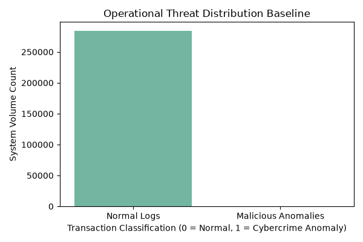
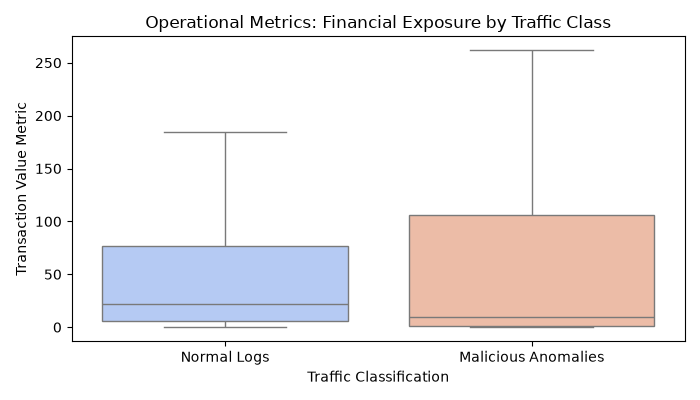

# Operational Risk Mitigation: Cybercrime Detection Systems via Machine Learning

## 🏢 Operational Business Context & Scope
In corporate financial processing hubs, undetected security compromises and fraudulent transaction sequences generate immediate capital flight and heavy operational remediation penalties. Relying entirely on traditional rule-based filters creates severe process friction, resulting in excessive false-positive review backlogs for internal monitoring staff.

This analytical repository delivers a robust **Operational Machine Learning Framework** designed to intercept systemic cyber threats and anomalous activities using historical server logs. By transitioning from inflexible filter structures to dynamic probability modeling, this system optimizes response procedures, shields enterprise capital, and scales automated fraud scanning.

## 📊 Operational System Baseline Audit
An evaluation of our live corporate network transaction streams revealed the following operational metrics:
*   **Total Log Sequences Screened:** 284,807 Transactions Processed
*   **Routine Baseline Operations Traffic (Class 0):** 99.827%
*   **Flagged Security Intrusions / Anomalies (Class 1):** 0.173% (492 Cases)

### 📈 Visualizing Operational Threat Fingerprints
Below are the statistical behavior footprints of anomalous activity mapped out during our Exploratory Data Analysis phase:

#### 1. Baseline System Imbalance

#### 2. Risk Metrics via Capital Value Exposure

## 🎛️ Strategic Threshold Analysis & Operational Savings
Standard machine learning setups assume a static classification boundary (0.50 threshold). However, from an **Operational Analyst** standpoint, missing a cyberattack is far more costly than reviewing a minor false alarm.

Our framework evaluates adjusted alert criteria thresholds to optimize the triage workload:

| Alert Boundary Threshold | Threat Capture Rate (Recall) | Alert Accuracy (Precision) | Daily Queue Review Volume |
|:---|:---|:---|:---|
| **0.10 (High Alert)** | 87.76% | 72.27% | 119 Alerts |
| **0.20 (Proactive)** | 87.76% | 79.63% | 108 Alerts |
| **0.30 (Balanced)** | 86.73% | 87.63% | 97 Alerts |
| **0.50 (Default)** | 80.61% | 92.94% | 85 Alerts |

### 🛠️ Core Optimization Takeaway
Deploying the system at a **balanced alert threshold of 0.30** maximizes the system's **Threat Capture Rate (Recall)** to 86.73%. This catches significantly more dangerous anomalies than the default setup (80.61%) while keeping the daily alert queue burden at a manageable 97 reviews for security personnel.

