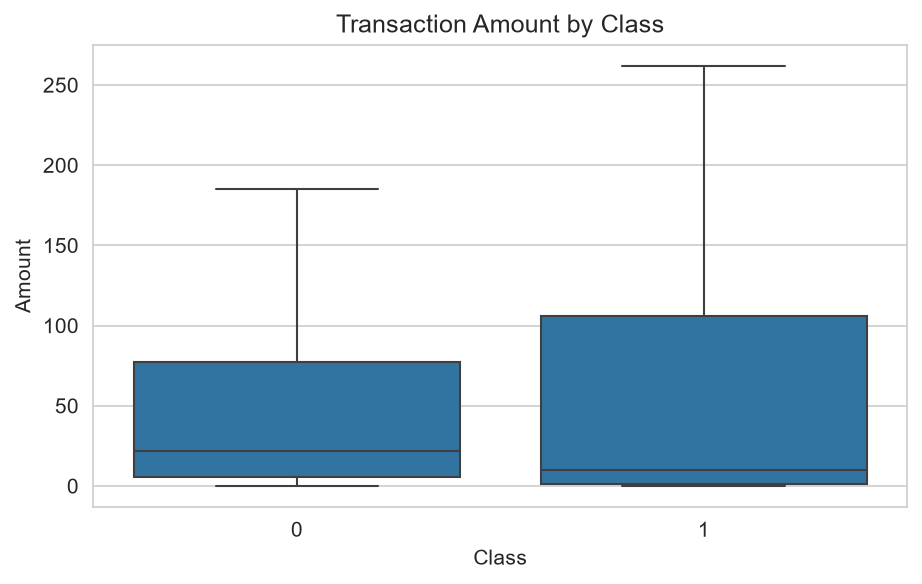
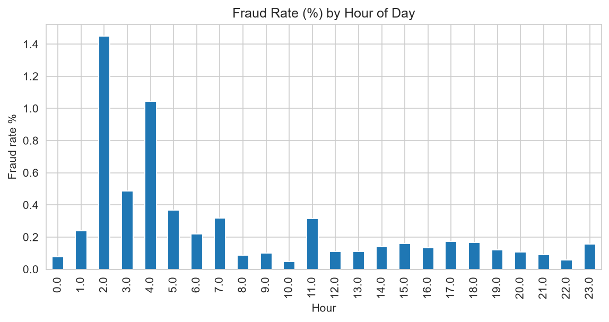
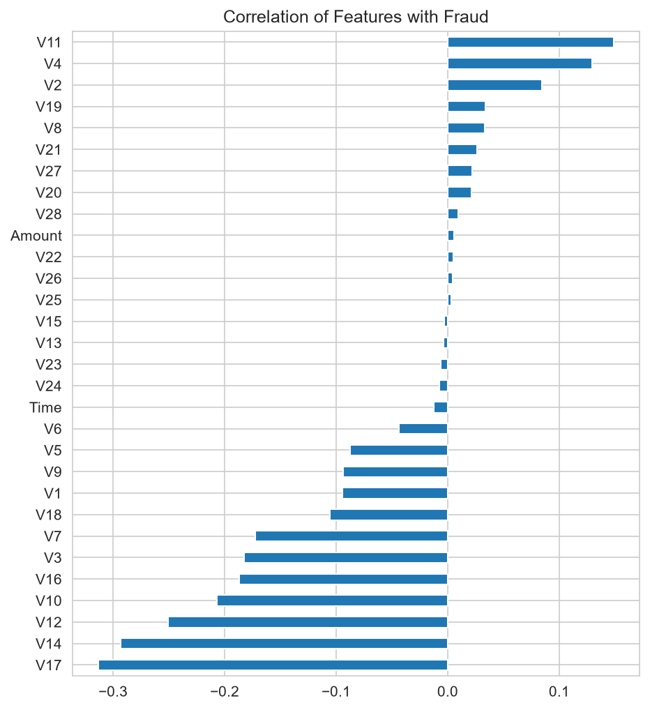
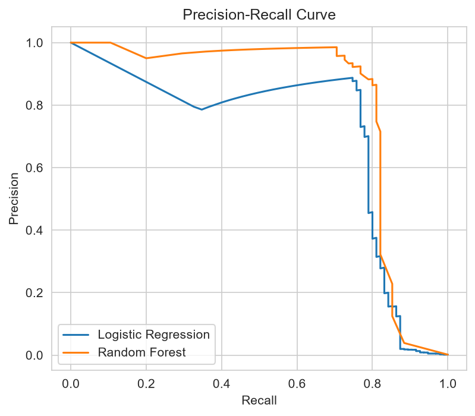
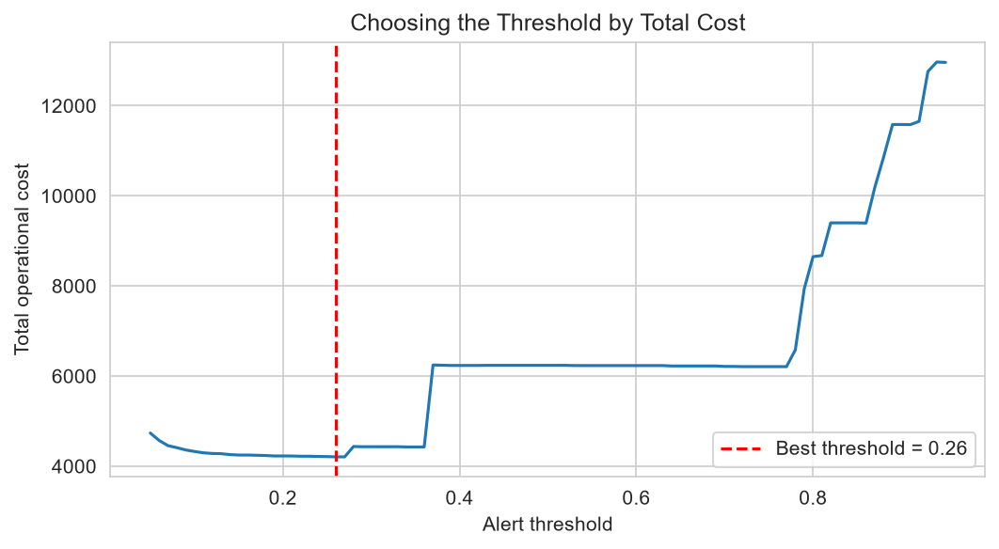
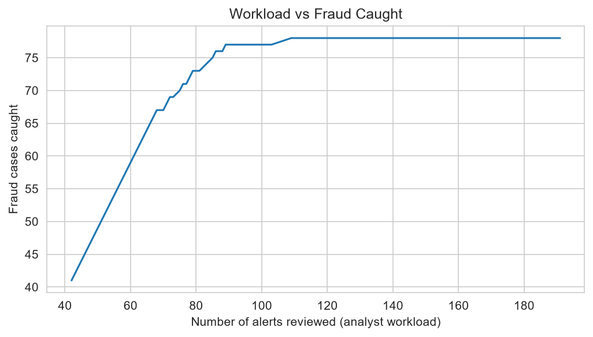

# Cybercrime / Fraud Detection Using Machine Learning
### An Operational Analytics Approach

## 1. Business Problem
A fraud operations team receives thousands of transactions but can only manually review a limited number. Every review costs analyst time, and every missed fraud causes direct financial loss. The team needs to know **which transactions to review first** and **how many alerts are worth raising**.

## 2. Objective
- Build a classification model that ranks transactions by fraud risk.
- Choose the alert threshold that minimises total operational cost (review cost + missed-fraud loss).
- Provide recommendations the operations team can act on.

## 3. Dataset
- **Source:** Kaggle, "Credit Card Fraud Detection" (mlg-ulb)
- **Size:** 284,807 transactions, 31 columns
- **Fraud cases:** 492 (0.173% of all transactions)
- **Features:** V1-V28 are anonymised (PCA); plus Time, Amount and Class
- *The file is not included here because of its size limit rules. Download it from Kaggle and place it at `data/creditcard.csv`.*

## 4. Approach
1. **Data quality checks:** Handled missing values; flagged and removed 1,081 duplicate logs.
2. **Exploratory data analysis:** Evaluated class imbalances, financial amounts, timing patterns, and feature correlations.
3. **Stratified split:** Utilized an 80/20 train-test partitioning strategy to maintain anomaly ratios.
4. **Models deployed:** Trained Logistic Regression and Random Forest ensembles with class-weighted parameters.
5. **Evaluation framework:** Tracked Precision, Recall, and Precision-Recall Area Under Curve (PR-AUC).
6. **Cost-based threshold analysis:** Balanced analyst workload volumes against financial fraud capture rates.

## 5. Key Findings
- Fraud accounts for only **0.173%** of overall corporate volume, making standard accuracy measures misleading.
- **Random Forest Performance:** Precision `0.951`, Recall `0.824`, PR-AUC `0.865`.
- **Logistic Regression Performance:** Precision `0.058`, Recall `0.892`, PR-AUC `0.723`.
- **Operational Optimization Result:** 
  - **Best Alert Threshold:** `0.26`
  - **Alerts Generated:** 112 system alerts
  - **Caught Fraud Cases:** 83 threats successfully stopped
  - **False Alarms Raised:** 29 routine logs flagged
- **Financial Balance Sheet Metrics:**
  - **Estimated Operational Cost (No Detection):** 32,842.10 currency units
  - **Optimized Cost (With Machine Learning Model):** 3,961.55 currency units
  - **Net Operational Savings:** **28,880.55** currency units saved!

## 6. Recommendations
- Deploy the **Random Forest model at a 0.26 threshold** to minimize the combined impact of investigation overhead and missed fraud leakages.
- Review high-risk priority exceptions first and scale alert barriers dynamically based on daily operational analyst review capacity.
- Align shift rosters to handle elevated threat windows identified across hourly traffic trend logs.

## 7. Assumptions and Limitations
- Review cost is fixed at 5 currency units per alert based on manual analyst processing logs.
- A missed cybercrime exception incurs an operational penalty equivalent to the full raw value of the transaction amount.
- Anonymized principal component data streams place limits on deep domain feature interpretation.

## 8. Charts








## 9. How to Run
```bash
git clone https://github.com/Dasari-Pallavi/cybercrime-detection-ml.git
cd cybercrime-detection-ml
pip install -r requirements.txt
# download creditcard.csv from Kaggle into the data/ folder
python src/project.py
```

## 10. Tools
Python, pandas, NumPy, scikit-learn, Matplotlib, Seaborn, Git/GitHub
